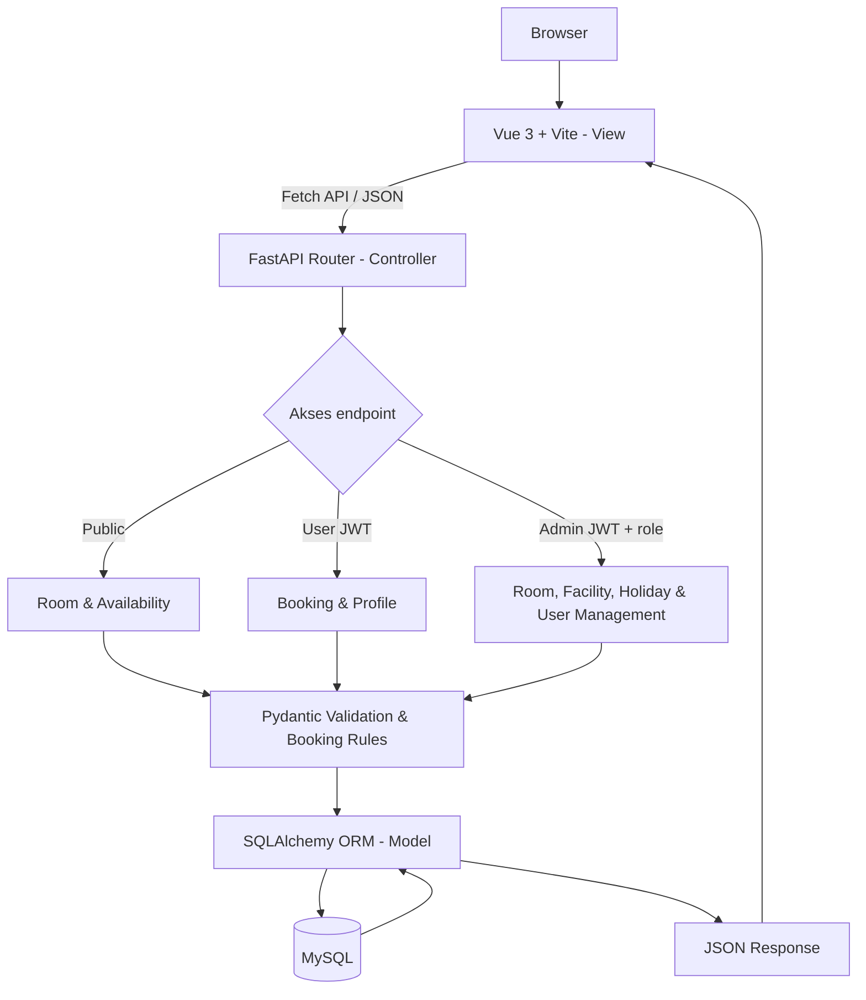

# Architecture — TechnoPark

Aplikasi **SPA full-stack**: Vue 3 + Vite menampilkan halaman, FastAPI menangani REST API dan validasi, SQLAlchemy mengakses MySQL. MySQL berjalan di Docker saat pengembangan lokal. Akses katalog publik, sedangkan booking membutuhkan login.

## One request end to end

Alur booking: pengunjung memilih ruangan, tanggal, dan salah satu dari 5 slot → login/daftar jika perlu → FastAPI memeriksa aturan tanggal, satu booking per user/tanggal, dan konflik room/slot → transaksi database menyimpan booking → Vue menampilkan konfirmasi atau pesan gagal.

## Routing API (rencana)

| Akses | Method | Endpoint | Fungsi |
| --- | --- | --- | --- |
| Public | GET | `/api/rooms`, `/api/rooms/{id}` | Katalog dan detail ruangan |
| Public | GET | `/api/rooms/{id}/availability?date=...` | Slot tersedia pada tanggal pilihan |
| Public | GET | `/api/time-slots`, `/api/holidays` | Slot tetap dan hari tutup |
| Public | POST | `/api/auth/register`, `/api/auth/login` | Daftar dan masuk |
| User | GET | `/api/auth/me`, `/api/bookings/me`, `/api/bookings/{id}` | Profil, riwayat, dan detail sendiri |
| User | POST | `/api/bookings` | Buat reservasi |
| User | PATCH | `/api/bookings/{id}` | Ubah jadwal sendiri dengan validasi ulang |
| User | DELETE | `/api/bookings/{id}` | Batalkan booking (soft cancel) |
| Admin | GET/POST/PATCH/DELETE | `/api/admin/rooms`, `/api/admin/facilities` | Kelola data master |
| Admin | GET/POST/PATCH/DELETE | `/api/admin/holidays` | Kelola kalender hari tutup |
| Admin | GET/POST/PATCH/DELETE | `/api/admin/users`, `/api/admin/bookings` | Kelola pengguna dan booking; DELETE mempertahankan histori |

## Layers and responsibilities

| Layer | Lokasi rencana | Tanggung jawab |
| --- | --- | --- |
| View | `frontend/src/` | Vue components, halaman publik/user/admin, responsive UI, status loading/error |
| API / Controller | `backend/routers/` | Routing, JWT, hak akses, HTTP response |
| Validation | `backend/schemas/` | Pydantic, input booking, tanggal dan slot |
| Model | `backend/models/`, `backend/database.py` | SQLAlchemy ORM, relasi, query, transaksi MySQL |
| Database | MySQL + `backend/alembic/` | Penyimpanan data, foreign key, unique index, migrasi |

JWT dikirim melalui header `Authorization` dan hanya disimpan di memori frontend; logout menghapus token. Tanpa cookie autentikasi yang terkirim otomatis, API bearer tidak membuka mekanisme CSRF berbasis cookie; input tetap divalidasi, output ditampilkan aman, dan query menggunakan ORM terparameterisasi. Backend memeriksa kepemilikan booking dan role admin. Booking dibuat dalam transaksi dengan constraint unik untuk mencegah bentrok. Desain web mengikuti identitas TechnoPark: biru `#2563EB`, cyan `#06B6D4`, tampilan terang dan kartu responsif.

`GET /api/calendar` menyatakan tahun kalender yang telah diaudit, berdasarkan environment `HOLIDAY_CALENDARS` (tahun → URL sumber resmi); tanggal penutupan tetap berasal dari tabel `holidays`. Tahun yang belum diaudit diblokir secara terlihat. Import opsional `manage_calendar.py` menyediakan data nasional 2026–2027, dengan aktivasi lokal eksplisit. Penutupan ruang/tanggal baru ditampilkan sebagai konflik operasional pada booking lama tanpa pembatalan otomatis.

Timestamp kejadian disimpan sebagai UTC tanpa offset pada MySQL, sedangkan tanggal/slot divalidasi dalam `Asia/Jakarta`. Pembacaan riwayat dan ringkasan menyinkronkan status `completed` setelah waktu selesai. Pembatalan/perubahan selalu memeriksa waktu mulai saat request.

Deploy: Cloudflare Pages (`frontend/dist`, SPA fallback) → Railway API (`backend`, Docker/Uvicorn satu worker, Alembic pre-deploy) → Railway MySQL private persisten. Lokal memakai MySQL Compose `db` port 3307; pytest dan browser test hanya memakai `db-test` port 3308 dengan schema hasil migrasi asli.
