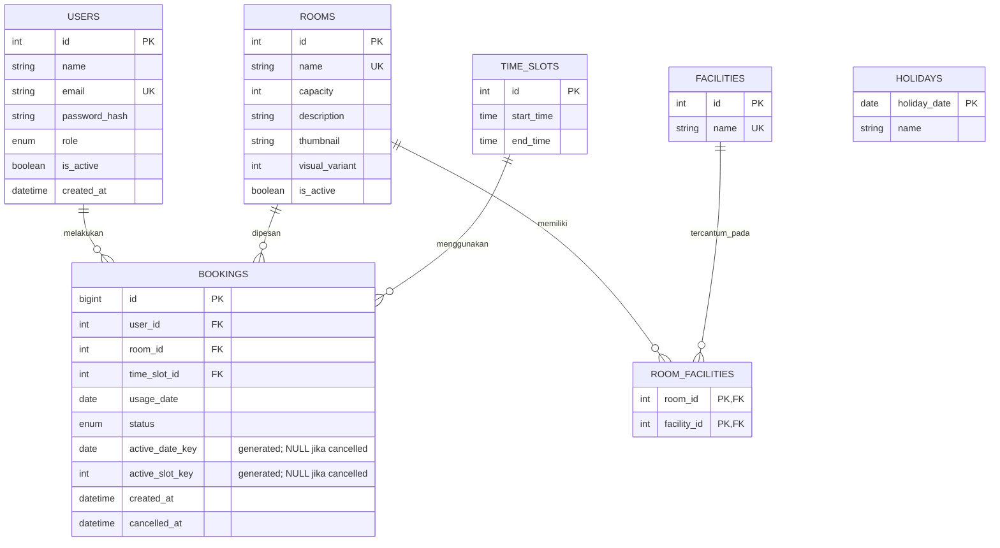

# ERD TechnoPark

Database MySQL untuk sistem booking gratis dengan 2 role (`user` dan `admin`). Terdapat 7 tabel; ketersediaan ruangan dihitung berdasarkan tanggal penggunaan dan slot, bukan hanya status ruangan.

## Kardinalitas dan aturan

- Satu **user** dapat memiliki banyak booking; satu **room** dan satu **time slot** dapat muncul di banyak booking pada tanggal yang berbeda. Semua foreign key booking wajib ada (`ON DELETE RESTRICT`).
- Hubungan **rooms** dan **facilities** adalah many-to-many melalui `room_facilities` (primary key gabungan); catatan penghubung mengikuti penghapusan relasinya (`ON DELETE CASCADE`).
- `bookings.status`: `upcoming`, `completed`, atau `cancelled`. Pembatalan mengubah status, **tidak menghapus riwayat**; booking yang dibatalkan boleh digantikan.
- Dua unique index MySQL: **(`user_id`, `active_date_key`)** dan **(`room_id`, `usage_date`, `active_slot_key`)**. Kedua kolom `active_*` dibuat sebagai *generated columns* yang bernilai `NULL` jika dibatalkan. Ini mencegah booking ganda sekalipun ada dua request bersamaan.
- `usage_date` adalah **tanggal penggunaan**, bukan tanggal membuat booking. Satu akun maksimal satu booking yang belum dibatalkan per tanggal penggunaan; beberapa tanggal berbeda boleh dipesan pada hari yang sama.
- `time_slots` berisi tepat **09:00–11:00, 11:00–13:00, 13:00–15:00, 15:00–17:00, 17:00–19:00 WIB**. Minggu, tanggal lampau, slot yang sudah dimulai, dan tanggal dalam `holidays` tidak boleh dipesan; validasi dilakukan di backend.

Seed `rooms` mempertahankan 9 ruangan: **Ruang Adi Soemarmo, Ruang Balapan, Ruang Jebres** (4 orang); **Ruang Tirtonadi, Ruang Purwosari, Ruang Solo Kota** (6 orang); **Ruang Batik Solo Trans, Ruang Kerten, Ruang Kleco** (8 orang). Tabel `holidays` berdiri sendiri sebagai daftar tanggal libur nasional terkonfigurasi.

Cakupan tahun kalender terverifikasi berada pada konfigurasi deployment `HOLIDAY_CALENDARS`, bukan tabel tambahan. Tahun yang belum tercakup ditolak sebelum booking. Admin mengarsipkan ruang dan menonaktifkan akun; tujuh tabel inti dan FK histori tetap dipertahankan. Tabel `alembic_version` hanya metadata migrasi.
